

<!-- ========================================================================= -->
<!-- ✦ TOP DESKTOP DOCK: POWERSHELL FLOWER TERMINAL • CYBER ROOM • NOW PLAYING ✦ -->
<!-- ========================================================================= -->

<table border="0" cellpadding="0" cellspacing="0" width="100%">
  <tr>
    <td width="54%" valign="top">
      
    </td>
    <td width="2%" valign="top"></td>
    <td width="23%" valign="top">
      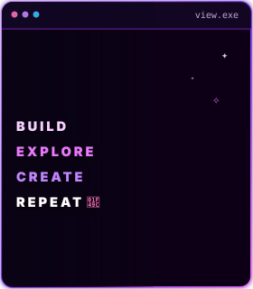
    </td>
    <td width="2%" valign="top"></td>
    <td width="19%" valign="top">
      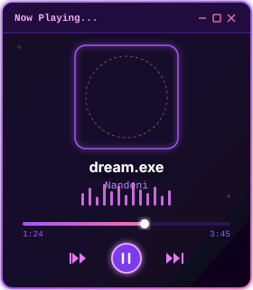
    </td>
  </tr>
</table>

<!-- ========================================================================= -->
<!-- ✦ HERO BANNER: NANDENI TIWARI • CELESTIAL ORBITS • Y2K CYBER-PRINCESS ✦ -->
<!-- ========================================================================= -->

 

  

 

<!-- ========================================================================= -->
<!-- ✦ ROW 1: ABOUT ME • CURRENTLY FOCUS • GOALS.EXE ✦ -->
<!-- ========================================================================= -->

<table border="0" cellpadding="0" cellspacing="0" width="100%">
  <tr>
    <td width="31%" valign="top">
      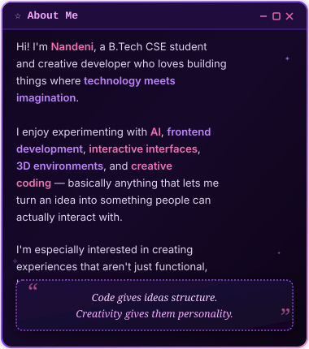
    </td>
    <td width="2%" valign="top"></td>
    <td width="41%" valign="top">
      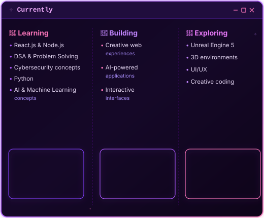
    </td>
    <td width="2%" valign="top"></td>
    <td width="24%" valign="top">
      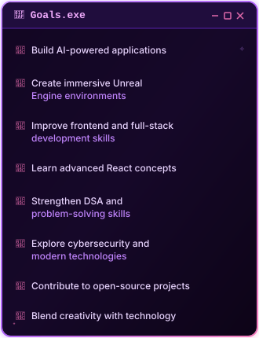
    </td>
  </tr>
</table>

 

<!-- ========================================================================= -->
<!-- ✦ ROW 2: TECH STACK • FEATURED PROJECTS • CONNECT & FUN SIDE ✦ -->
<!-- ========================================================================= -->

<table border="0" cellpadding="0" cellspacing="0" width="100%">
  <tr>
    <td width="31%" valign="top">
      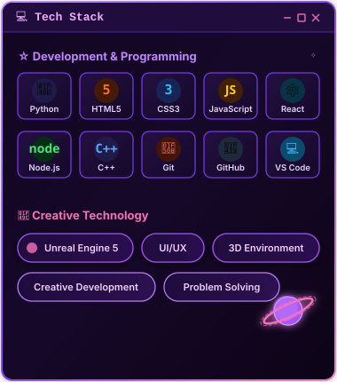
    </td>
    <td width="2%" valign="top"></td>
    <td width="41%" valign="top">
      <a href="https://github.com/Nandeniworks?tab=repositories">
        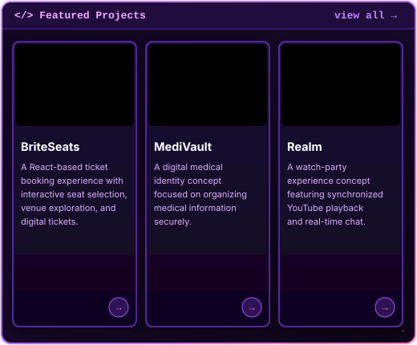
      </a>
      <!-- Direct Project Quick Links for 1-Click Navigation -->
      <table border="0" cellpadding="0" cellspacing="0" width="100%">
        <tr align="center">
          <td width="33%"><a href="https://github.com/Nandeniworks/Brite_Seats"><code>✦ BriteSeats ↗</code></a></td>
          <td width="34%"><a href="https://github.com/Nandeniworks/MediVault"><code>✦ MediVault ↗</code></a></td>
          <td width="33%"><a href="https://github.com/Nandeniworks/Realm"><code>✦ Realm ↗</code></a></td>
        </tr>
      </table>
    </td>
    <td width="2%" valign="top"></td>
    <td width="24%" valign="top">
      <a href="https://github.com/Nandeniworks">
        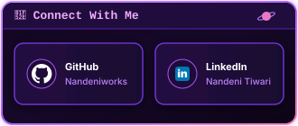
      </a>
        
      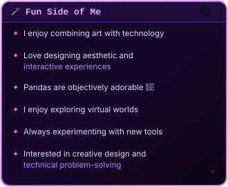
    </td>
  </tr>
</table>

 

<!-- ========================================================================= -->
<!-- ✦ ROW 3: GITHUB STATS • MOST USED LANGUAGES • CONTRIBUTION SNAKE ✦ -->
<!-- ========================================================================= -->

<table border="0" cellpadding="0" cellspacing="0" width="100%">
  <tr>
    <td width="31%" valign="top">
      <a href="https://github.com/Nandeniworks">
        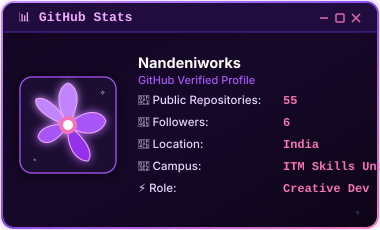
      </a>
    </td>
    <td width="2%" valign="top"></td>
    <td width="30%" valign="top">
      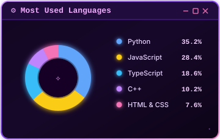
    </td>
    <td width="2%" valign="top"></td>
    <td width="35%" valign="top">
      <a href="https://github.com/Nandeniworks/Nandeniworks/actions/workflows/snake.yml">
        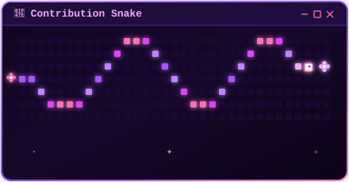
      </a>
    </td>
  </tr>
</table>

 

<!-- ========================================================================= -->
<!-- ✦ DESKTOP TASKBAR & DYNAMIC TYPING STATUS ✦ -->
<!-- ========================================================================= -->

  

  

<!-- ========================================================================= -->
<!-- ✦ INTERACTIVE SYSTEM MANIFEST (ACCESSIBLE TEXT & VERIFIED SOCIALS) ✦ -->
<!-- ========================================================================= -->

<b>💜 Click to view Nandeni's Raw System Manifest &amp; Direct Social Links</b>

 

<blockquote>

  <b>Nandeni Tiwari</b> • B.Tech CSE Student &amp; Creative Developer 
  <i>"Code gives ideas structure. Creativity gives them personality."</i>

</blockquote>

### ✦ Quick Navigation &amp; Social Coordinates
- **GitHub Profile**: [@Nandeniworks](https://github.com/Nandeniworks)
- **LinkedIn Network**: [Nandeni Tiwari on LinkedIn](https://www.linkedin.com/in/nandeni-tiwari-7588a136b/)
- **Core Focus**: AI Engineering, Modern Frontend, Unreal Engine 5, 3D Interactive Environments, Creative Coding

### ✦ Featured Repositories
1. **[Brite_Seats](https://github.com/Nandeniworks/Brite_Seats)** — A React ticket booking experience with interactive seat selection, venue exploration, and digital tickets.
2. **[MediVault](https://github.com/Nandeniworks/MediVault)** — Digital medical identity concept focused on organizing medical information securely.
3. **[Realm](https://github.com/Nandeniworks/Realm)** — Synchronized YouTube watch-party experience concept with real-time chat.
4. **[Bubbleverse](https://github.com/Nandeniworks/Bubbleverse)** — Interactive canvas & creative coding experiments.
5. **[Al-Powered-Resume-Builder](https://github.com/Nandeniworks/Al-Powered-Resume-Builder)** — Automated resume generation powered by modern AI pipelines.

### ✦ Tech Stack Inventory
- **Languages**: Python, JavaScript, TypeScript, C++, HTML5, CSS3, Java
- **Frameworks & Tools**: React.js, Node.js, Git, GitHub, VS Code, Unreal Engine 5
- **Specializations**: UI/UX Design, 3D Environment Design, Creative Web Development, DSA & Problem Solving

 

  Designed with 💜 for <b>Nandeni Tiwari</b> • Dark Y2K Cyber-Princess Desktop Edition

